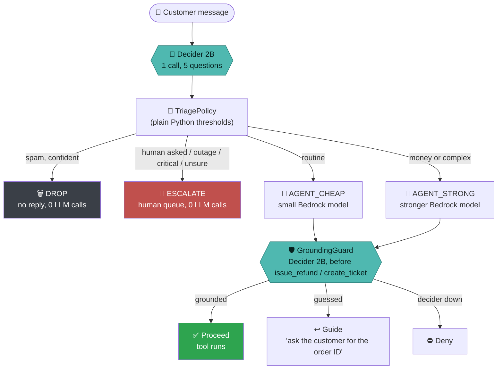
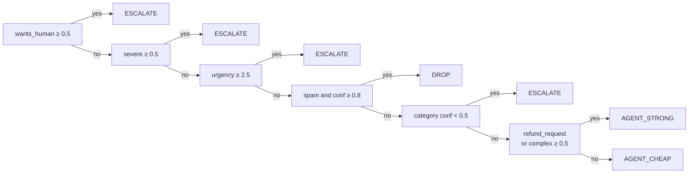
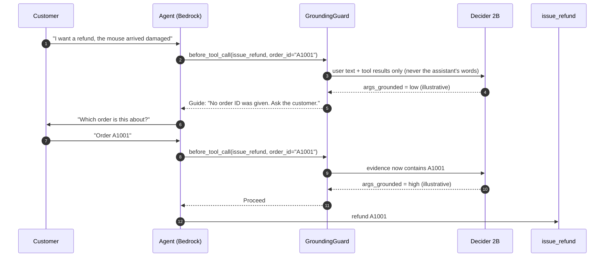
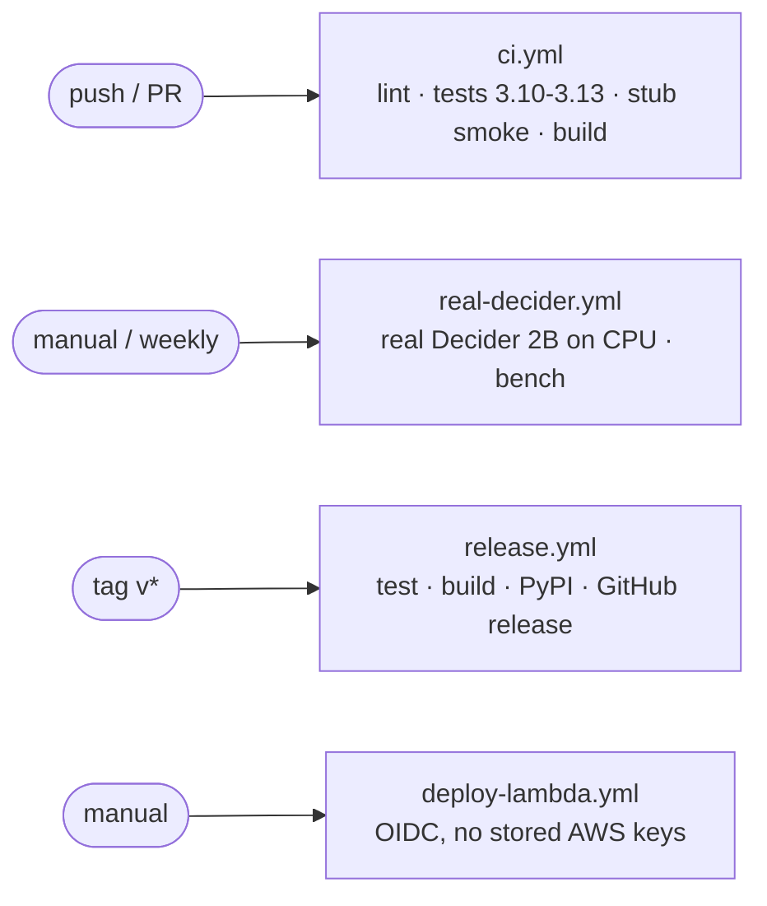

<div align="center">

# 🧭 decider-triage

**A support agent where a 2B decision model makes the calls and the LLM only writes text.**

[](https://github.com/Hasalawa/decider-triage/actions/workflows/ci.yml)


`#strands-decider-2b` &nbsp; `#policy`

*Built for the Agent Experience Hackathon: Strands Decider.*

</div>

---

## ⚡ The idea in 10 seconds

| Without Decider | With Decider |
|---|---|
| Every message goes to a big LLM, even spam | Spam is dropped **before** any LLM call |
| The LLM decides if it should escalate, in prose | A model returns **numbers**, plain Python applies the **policy** |
| The agent can guess a tool argument (an order ID) and refund the wrong thing | A guard checks the argument is **grounded** in what the customer said |

---

## 🗺️ How a message flows



**The model only returns numbers. The thresholds are code** (`TriagePolicy` in
[`triage.py`](src/triage_agent/triage.py)), so you can read, test and change the policy without
touching a model. If the Decider is unreachable, triage **fails safe to a human**.

---

## 🧠 What the Decider decides

| # | Question | Type | Used for |
|---|---|---|---|
| 1 | Which kind of request is this? (refund, billing, bug, access, how-to, spam) | `choice` | category + confidence |
| 2 | How urgent is it? (low → critical) | `score` | escalate if critical |
| 3 | Does the customer ask for a human or threaten legal action? | `noul` | escalate |
| 4 | Is it a security incident, outage or data loss? | `noul` | escalate |
| 5 | Does it need several steps or a judgment call? | `noul` | strong model |
| 🛡️ | Are the tool arguments grounded in what the user said? | `noul` | guard |
| 🛡️ | Is this tool call premature? | `noul` | guard |

### The routing policy (first match wins)



---

## 🛡️ Reusable decision pattern: `GroundingGuard`

[`decision_pattern.py`](src/triage_agent/decision_pattern.py) is **one file** you can drop into any Strands agent:

```python
from triage_agent.decider_client import DeciderClient
from triage_agent.decision_pattern import GroundingGuard

guard = GroundingGuard(DeciderClient(), tools={"issue_refund"})
agent = Agent(model=..., tools=[issue_refund], interventions=[guard])
```



| Piece | Detail |
|---|---|
| **Questions** | `args_grounded`, `premature` (both `noul`) |
| **Wiring** | Strands `InterventionHandler.before_tool_call` |
| **Verdicts** | `Proceed`, `Guide` (the model gets its turn back with feedback), `Deny` (only if the Decider is down) |
| **Evidence rule** | The guard shows the Decider only user text and tool results, so a guessed argument **cannot vouch for itself** |

---

## 📊 Real results

Measured on a laptop **CPU** with the real `strands-decider-2B-hobson-v19` (not the stub).
The 54 hand-labeled messages are split into **24 dev** (used while building) and **30 held-out
test** (run once, never tuned on).

| Split | Correct | Accuracy | |
|---|---|---|---|
| Dev (before adding the "severe" question) | 19 / 24 | **79.2%** | `████████████████░░░░` |
| Held-out test | 24 / 30 | **80.0%** | `████████████████░░░░` |

**Test set, per route** (how many messages the policy sent to the right place):

| Route | Correct | |
|---|---|---|
| 🙋 ESCALATE | 7 / 7 | `██████████` |
| 🦾 AGENT_STRONG | 6 / 7 | `█████████░` |
| 🤖 AGENT_CHEAP | 10 / 12 | `████████░░` |
| 🗑️ DROP | 1 / 4 | `██░░░░░░░░` |

| Metric | Value |
|---|---|
| LLM calls on the test set | **20** with routing vs **30** if everything went to the strong model |
| Decider latency, laptop CPU | p50 ≈ **14 s** per message |
| Decider latency, official numbers | ≈ 115 ms (RTX 3090) / ≈ 153 ms (M3 Pro), warm |

> **Honest reading:** escalation is solid, spam dropping is weak (only 1 of 4 spam messages was dropped; the
> other 3 took another route, which is the safer direction than dropping a real customer). The CPU latency
> is a hardware fact of my laptop, not of the model. Run `triage-bench` on your own machine.

---

## 🚀 Quick start

```bash
git clone https://github.com/Hasalawa/decider-triage && cd decider-triage
pip install -e ".[dev]"
pip install strands-decider              # the real model (needs torch)

strands-decider serve StrandsAgents/strands-decider-2B-hobson-v19 --port 8099
# (add --device cpu if you have no GPU)

triage-agent --triage-only "I would like a refund for order A1001"   # Decider only, no AWS
triage-agent "How do I turn on dark mode?"                           # full flow, needs Bedrock
python examples/demo.py                                              # the demo from the video
triage-bench --split test                                            # accuracy / latency / cost
```

### 🖥️ Try it in a browser

```bash
python -m triage_agent.ui          # then open http://127.0.0.1:8088
```

Type a message, press **Triage**: you see the route, the numbers the Decider returned and,
if you tick the box (needs AWS), the agent reply and the guard's verdicts.

### ☁️ Bedrock model IDs

Model IDs differ by region and account. List what your account can use and get the two lines to paste:

```bash
python -m triage_agent.models
# $env:TRIAGE_CHEAP_MODEL  = "..."     (PowerShell)
# $env:TRIAGE_STRONG_MODEL = "..."
```

New AWS accounts may need Anthropic's one-time use-case form and a quota increase before
Claude models respond. Without AWS, `--triage-only` and the UI (box unticked) still work.

### 🧪 Run without downloading the model

`triage-fake-decider` is a **keyword stub** with the same HTTP API. CI and unit tests use it.
It is **not a model**: numbers measured against it say nothing about Decider 2B, and
`triage-bench` prints the server's model name so the two cannot be confused.

---

## ⚙️ CI/CD (GitHub Actions)



| Workflow | When | What |
|---|---|---|
| `ci.yml` | push, PR | ruff lint + format, tests on Python 3.10-3.13 with coverage, pipeline smoke test, build + `twine check` |
| `real-decider.yml` | manual, weekly | serves the real Decider 2B on CPU and runs `triage-bench`, writes the JSON to the job summary |
| `release.yml` | tag `v*` | checks tag == package version, tests, builds, publishes to PyPI via Trusted Publishing, creates a GitHub release |
| `deploy-lambda.yml` | manual | optional, builds a Lambda zip and deploys it with GitHub OIDC |
| `dependabot.yml` | weekly | pip and Actions updates |

One-time setup for each: [docs/DEPLOY.md](docs/DEPLOY.md).

---

## 🗂️ Layout

```
src/triage_agent/
├── decider_client.py    typed client for POST /v1/systemone (httpx only)
├── triage.py            policy decision: questions + thresholds -> route
├── decision_pattern.py  ⭐ REUSABLE: GroundingGuard InterventionHandler
├── pipeline.py          route -> drop / escalate / cheap / strong
├── agent.py, tools.py   Bedrock-backed Strands agent and its tools
├── backend.py           in-memory orders, refunds, tickets, human queue
├── bench.py             accuracy / latency / cost report (dev / test split)
├── ui.py                local web page for demos
├── models.py            lists the Claude models your account can use
└── fake_decider.py      keyword stub for CI (not a model)
tests/                   39 tests, no AWS and no model download needed
```

---

## ⚠️ Limitations (honest list)

- Decider 2B is an experimental model (about 72% on JevBench overall). Thresholds were picked by
  hand, not tuned, and 54 messages is far too few to say anything about production accuracy.
- Dev score (79.2%) was measured **before** the "severe" question was added; the test split
  (80.0%) was run once with the final policy.
- Spam dropping is weak (1 of 4 on the test split); the policy prefers a human over a wrong drop.
- Latency numbers above are from a laptop CPU, not the official GPU setup.
- The backend is in-memory demo data.
- The guard is covered by unit tests and an integration test with a scripted model; its behavior
  with the real Decider and a real Bedrock model is only checked in `examples/demo.py`.

---

<div align="center">

MIT License · made for the **Agent Experience Hackathon: Strands Decider**

</div>